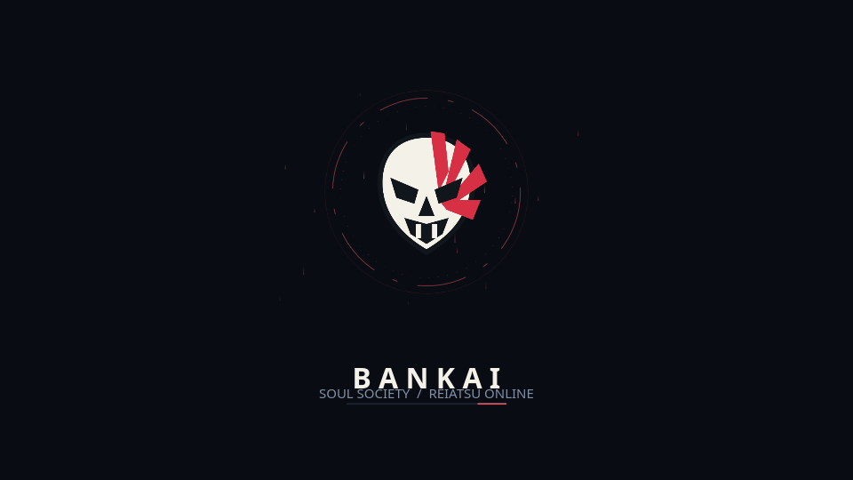
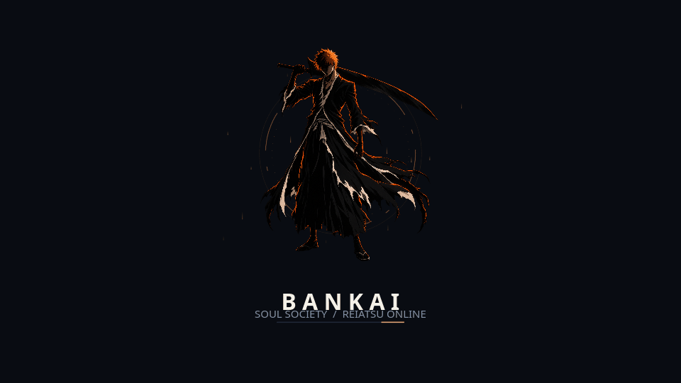

# Bankai randomized boot splash

An optional Plymouth theme for the Bleach desktop setup. One style is selected when the splash starts:

| Hollow mask | Ichigo silhouette |
| --- | --- |
|  |  |

The Hollow mask uses a crimson pulse and rotating aura. Ichigo uses an orange rim-lit silhouette and rising reiatsu particles. Both use the same dark palette, title and progress indicator. Consecutive boots can choose the same style; random selection does not mean alternation. This theme can also be shown during shutdown when Plymouth uses the same configured theme.

The preview GIFs come from the desktop renderer and illustrate the animation. They are not recordings of a real boot. Plymouth receives real boot progress when available; otherwise an indeterminate indicator animates. The theme adds no artificial boot delay. Very fast boots may show only a brief part of the animation.

## Current CachyOS setup

The development machine already has Plymouth, `splash` on its kernel command line and the `plymouth` mkinitcpio hook. It uses Limine and currently selects `details`. The installer detects `/etc/default/limine` and uses `/usr/bin/limine-mkinitcpio` to rebuild the boot images and refresh Limine integration. It otherwise uses `/usr/bin/mkinitcpio -P`.

The theme is optional and is not installed by either desktop edition's installer or included in their edition archives. Clone the repository to install it. It does not require the Python or Rust desktop control center to be running.

## Preview without changing boot settings

From the repository root, with PySide6 installed:

```bash
python3 boot/preview.py
```

The window lets you select either style or replay a random selection. It never starts the system Plymouth daemon or takes over your display/console. The checked-in GIFs above are another way to preview both styles. To regenerate those previews, install Pillow as well and run:

```bash
QT_QPA_PLATFORM=offscreen python3 boot/preview.py --export
```

## Activate on CachyOS

Preview the planned changes first; this command does not write system files:

```bash
python3 boot/install.py --dry-run
```

Then install and rebuild boot images:

```bash
sudo python3 boot/install.py
```

Activation needs system administrator access because it installs `/usr/share/plymouth/themes/bankai-random/`, selects it in `/etc/plymouth/plymouthd.conf` and rebuilds the initramfs. The installer preserves your bootloader/kernel command-line settings and requires the existing Plymouth hook. On this Limine setup it runs `limine-mkinitcpio` automatically; do not replace that step with the `/usr/local/bin/mkinitcpio` wrapper.

When the command finishes successfully, the new theme is ready for your next normal reboot. The workspace preview does not activate it, and no reboot is performed automatically.

Optional fixed modes are available for comparison:

```bash
sudo python3 boot/install.py --mode mask
sudo python3 boot/install.py --mode silhouette
sudo python3 boot/install.py --mode random
```

Original configuration and the installation receipt are retained under `/var/lib/bankai-plymouth/`. Updates retain the original configuration backup. Locally modified installed theme files block update/removal until you preserve or resolve those edits.

## Restore the previous theme

```bash
sudo python3 boot/install.py remove
```

This restores the previous theme setting, removes the managed Bankai theme, and rebuilds boot images using the same boot-manager helper. Unrelated edits to Plymouth configuration are preserved. If a rebuild fails, the installer restores the prior theme/configuration and attempts a recovery rebuild. A reported recovery failure must be resolved before rebooting.

## Validation and integration limits

The installed Plymouth script parser accepts the random and both fixed variants. Staging-root tests cover installation, original-setting restoration, updates, changed-file refusal, symlink rejection and simulated rebuild failure recovery. Desktop preview exports are checked separately. A real boot and disk-unlock interaction still require testing on the machine after activation.

Password and question callbacks are registered: the art dims, the supplied prompt appears, and passwords show asterisks. Escape retains Plymouth's normal access to boot messages. Multi-monitor layout, device-driver initialization and extremely small displays require live boot testing.

The original mask SVG comes from Bankai. The transparent character cutout is unofficial AI-generated Bleach fan art, excluded from the code MIT license; [prompt and asset provenance](ARTWORK.json). Aura, particle and bar graphics are generated by `build_assets.py` from code-native SVG geometry. Animation is performed by Plymouth at runtime, not by loading the preview GIFs.

References: [Plymouth overview](https://wiki.freedesktop.org/www/Software/Plymouth/), [CachyOS boot splash guidance](https://wiki.cachyos.org/cachyos_basic/faq/), and the installed `/usr/share/plymouth/themes/script/` examples. The script API was checked against the installed script plugin and the [upstream script library](https://gitlab.freedesktop.org/plymouth/plymouth/-/tree/main/src/plugins/splash/script).
