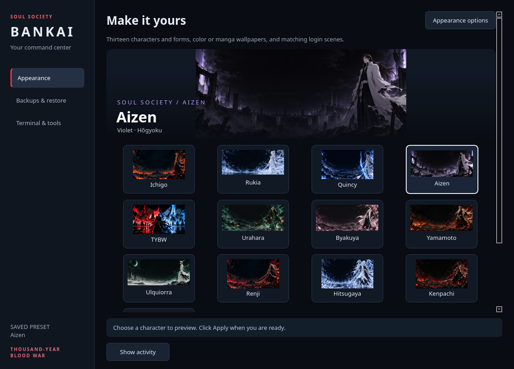
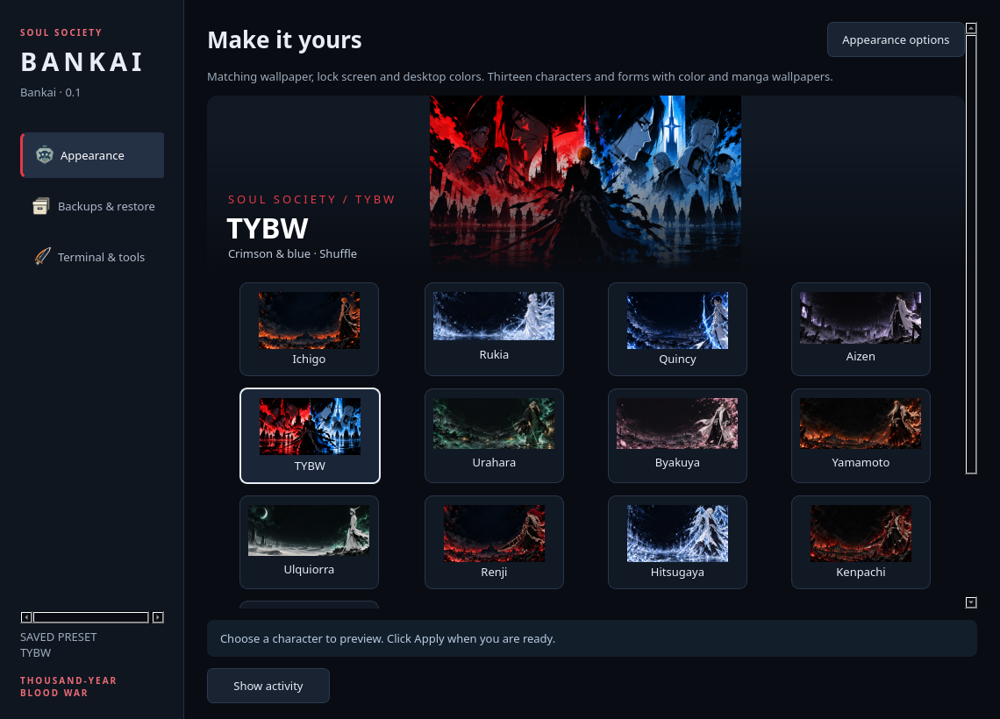
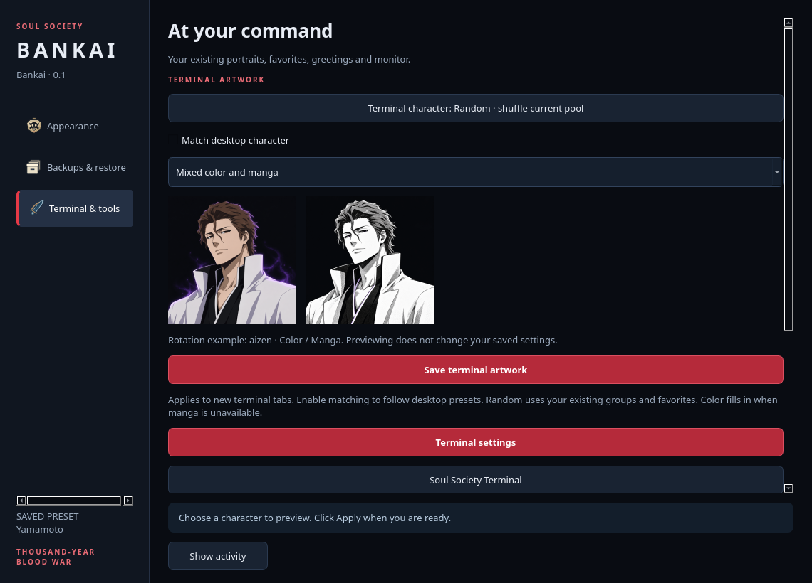
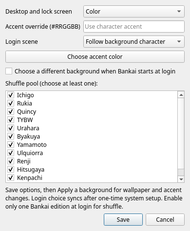
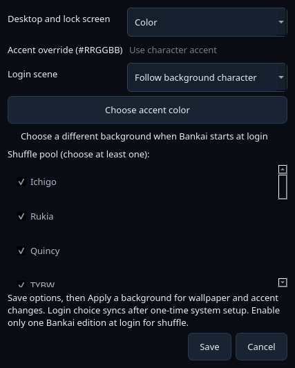

# Choose your Bankai edition

A [Windows edition using C# and WinUI 3](windows/README.md) is now in development.
Its initial preview includes character search and wallpaper previews; Windows
desktop integrations and Windows build/runtime verification remain pending.

Rust is the default desktop edition. Python remains available as an alternative. Both use the same terminal artwork and KDE desktop assets.

| | Rust + Qt Widgets · default | Python + PySide6 |
| --- | --- | --- |
| Install guide | **[Install Rust](rust/INSTALL.md)** | [Install Python](python/INSTALL.md) |
| Source and details | [Rust overview](rust/README.md) | [Python overview](python/README.md) |
| App command | `bankai` (`bankai-rust` also works) | `bankai-python` |
| App runtime | Compiled Rust core and Qt C++ view | Python and PySide6 |
| Build required | Yes: Rust/Cargo, C++17 and Qt development libraries | No |
| Terminal artwork controls | In-app selection and live color/manga preview | Fish settings menu |
| Portrait follows desktop | Optional; independent rotation is preserved by default | Presets select their matching portrait |
| Status | Default edition | Alternative edition |

Rust is the recommended desktop app, with live terminal-art previews and a smaller measured startup footprint on the development machine. [Benchmark details and limits](rust/README.md#measured-comparison) explain the comparison. Choose Python if you prefer the original implementation without a compilation step.

Each install guide is self-contained. You do not need to install the other control-center edition. Both need the shared terminal theme, whose Python/Fish helpers also run when using the Rust edition.

## Screenshots

| Python control center | Rust control center |
| --- | --- |
|  |  |

**Rust terminal artwork preview**



**Appearance controls**

| Python | Rust |
| --- | --- |
|  |  |

## Downloads and installers

[Choose a release download](https://github.com/vigilante-zen/bleach-kitty/releases). Python and Rust are packaged separately, each with the shared terminal theme and artwork. Assets appear after the release workflow succeeds. Run just your chosen installer from the package or repository root:

```bash
python3 desktop/install.py         # Rust default; builds source if needed
# Or choose explicitly:
python3 desktop/python/install.py  # Python alternative
```

Both bundle the optional manga-scene SDDM login theme. Open **Login screen setup** in either app to preview it and copy activation or restore commands. One-time administrator setup lets the login scene follow the selected desktop background in either edition.

Both support `--dry-run`, upgrades, `uninstall`, original-file backups and shared-asset ownership. Read the selected edition's install guide before running. No system dependencies are installed automatically.

## Switching editions

1. Disable login startup in the currently running edition and quit its tray app.
2. Follow the other edition's installation guide.
3. Launch the new edition and enable its login startup if desired.

The two commands can coexist. Their desktop presets, terminal preferences and snapshots are shared, so changes made by either edition affect the same desktop. Avoid applying changes from both at the same time. Python presets always select a matching terminal portrait; Rust's optional matching preference applies to Rust preset changes.

## Repository layout

- `python/`: Python source, command scripts, requirements and its own install guide.
- `rust/`: Rust/C++ source, build files and its own install guide.
- `shared/`: wallpapers, KDE color schemes and artwork prompts used by either edition.

[Back to the repository](../README.md) · [Artwork ownership and provenance](../docs/ARTWORK.md)

## Login startup

Choose **Start the Rust edition in the tray at login** in Rust, or the corresponding checkbox in Python. Disable the other edition before switching. Rust tray startup keeps its window hidden; when the tray is unavailable, the fallback window starts minimized. Repeated tray launches do not raise an existing control center. A normal app-menu launch opens the window.

These settings control Bankai only. Minimizing other restored applications is a per-user KDE session customization; it is not enabled for everyone by an edition installer. The development machine uses a separate login-only minimizer with a 20-second startup interval. Any app opened manually in that interval also minimizes; apps opened after it behave normally. This machine-specific helper and autostart entries are outside the repository and release archives.

## Appearance options shared by both editions

The background page offers Color/Manga wallpaper edition, an optional custom accent, fixed/following manga login scene, and a character pool for optional shuffle at login. Saving these options does not apply a desktop preset; use Apply afterward for wallpaper/accents. In the Rust edition, **Reset to defaults** confirms and restores the default options and TYBW desktop preset; saved custom presets and separate Fastfetch portrait preferences stay intact. Login-scene choice syncs after system setup. Preferences live in `~/.local/share/bleach-desktop/appearance.json`, survive updates/uninstall and are captured by desktop snapshots. The default is color wallpaper, character accent, following login scene, and no login shuffle.

Use **Save current choices** to store a named combination of the selected character wallpaper, accent and login-scene choice. Saved combinations can be previewed, applied and deleted in both editions; Bankai stores them in `~/.local/share/bleach-desktop/custom-presets.json`.

The eighteen presets include Nelliel, Aizen, Grimmjow, Yoruichi, Gin, Orihime, TYBW Renji, adult Bankai Hitsugaya, Bankai Kenpachi and Yhwach. Their manga scenes are available for both backgrounds and login. Rust's Terminal & tools page includes a searchable portrait grid with faction/form filters, recent and favorite selections, keyboard navigation and a persistent Random choice. Terminal artwork has its own Color/Manga/Mixed setting and rotation, including two additional TYBW forms. Original Ulquiorra art remains a legacy-arc option.
