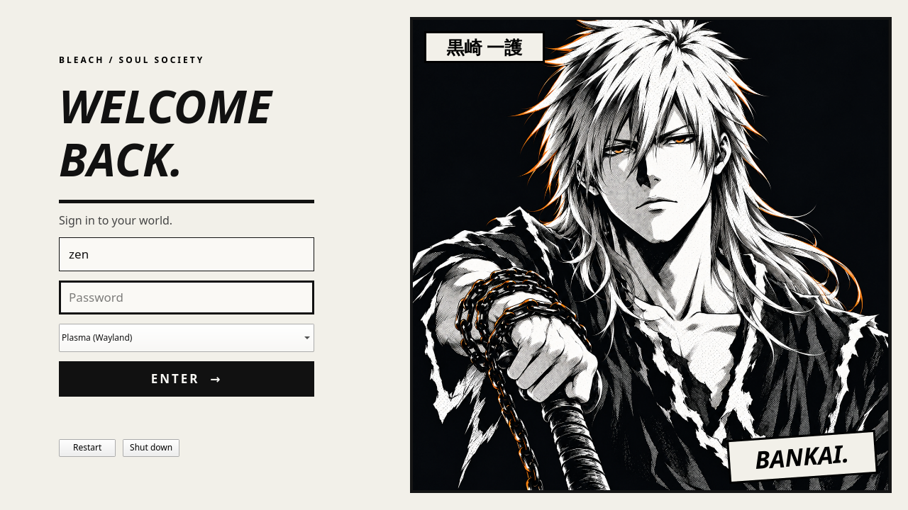

# Bankai Manga login screen

Optional SDDM / Qt 6 theme: paper background, ink borders, and the existing Dangai Ichigo manga portrait with subtle orange accents. Artwork follows [the artwork provenance and terms](../docs/ARTWORK.md). Code follows the repository MIT license.



From the extracted package or repository root, preview the real greeter without logging out (login and power actions are disabled in test mode):

```bash
sddm-greeter-qt6 --test-mode --theme ./login/theme
```

Install:

```bash
sudo python3 login/install.py
```

Both desktop edition installers bundle this theme and installer into `~/.local/share/bleach-desktop/`; both apps offer preview, install-command and restore-command controls. Activation remains optional and requires administrator access.

The installer adds a separate SDDM override and theme directory. Existing theme files and configuration remain intact. The override takes effect at the next login. Real authentication and multi-monitor behavior require testing on the login screen.

Restore the previous selection:

```bash
sudo python3 login/install.py restore
```

Restore removes the unchanged managed override, returning control to the existing SDDM configuration. Restore also removes the unchanged managed theme directory. Updates and restores refuse locally edited system files. No display-manager restart is performed.

`python3 login/preview.py` (PySide6) renders preview.png with dummy data. Theme API reference: https://github.com/sddm/sddm/wiki/Theming

## Updates and migration

Rerun the selected desktop installer to update the bundled theme, then rerun the administrator install command to update SDDM. The system installer also recognizes an exact copy installed by the earlier standalone shell installer. Edited or unrelated files block adoption. The installation receipt is stored in `/var/lib/bankai-login/receipt.json`.

The installer creates `/etc/sddm.conf.d/zz-bankai-manga.conf` and `/usr/share/sddm/themes/bankai-manga/`. Restore removes these managed files and reveals the previous configuration; no existing SDDM theme selection is overwritten. Another later-precedence override or `/etc/sddm.conf` can take priority over the Bankai selection.

For an isolated installation check, use `python3 login/install.py --root /absolute/staging/root --dry-run`. Without `--dry-run`, that staging root receives the files; the real system is unchanged. Both desktop installers support their own `--dry-run` and manage bundled login assets with shared edition ownership. Restore the system theme before uninstalling the last desktop edition if you need the installed helper to do so.
